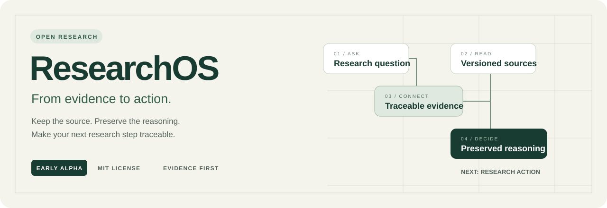
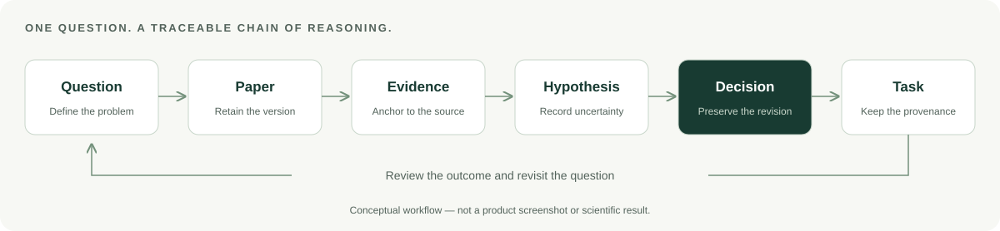
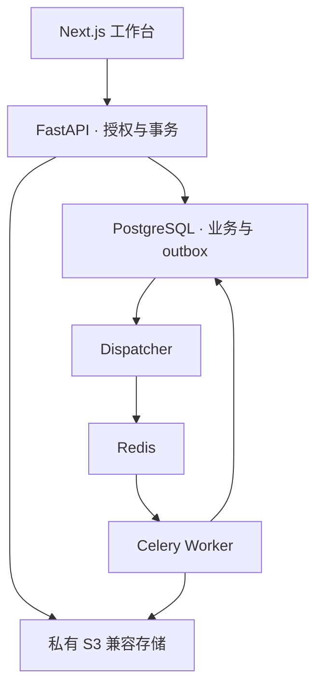

<p align="center"></p>

<h1 align="center">ResearchOS · 让每一次研究推进都有据可循</h1>

<p align="center">面向个人研究者的开源科研工作台<br/>连接研究问题、文献证据、假设、决策与任务，保留从阅读到行动的完整脉络。</p>

<p align="center">
  <a href="LICENSE"></a>
  
  
  
  <a href="https://github.com/Fancy8/ResearchOS/actions/workflows/verify.yml"></a>
</p>

<p align="center"><b>中文</b> · <a href="README_EN.md">English</a><br/>
<a href="#overview">项目介绍</a> · <a href="#features">核心能力</a> · <a href="#quickstart">快速开始</a> · <a href="docs/research-walkthrough.md">完整示例</a> · <a href="docs/README.md">文档导航</a> · <a href="docs/roadmap.md">路线图</a></p>

> **Early Alpha**：研究闭环与多项可靠性机制已实现，完整发布验收仍在推进。CI 徽章显示远端真实状态，本地历史结果单独注明日期。AI 功能与多人协作属于后续范围。

<a id="overview"></a>

## 🎯 项目介绍

阅读论文时记下的证据，几周后还能找到原文吗？一个实验任务，当初为什么值得做？假设调整后，旧决策使用的依据是否仍然清楚？

**ResearchOS 围绕研究问题组织工作，把文献证据、自己的判断和下一步行动连接起来。** 文献可以跨课题复用，证据保留来源版本与定位，决策保留修订及当时依据，任务关联确切的来源决策。复盘时，可以沿着这些关系找回研究推进的上下文。

适合正在开展文献综述、方法比较、实验规划与课题复盘的个人硕博生和研究者。它也为开发者提供一个全栈工程案例：如何用关系约束、事务、权限与故障恢复，支持需要保留历史的业务。



## ✨ 设计亮点

| 设计 | 具体做法 | 带来的价值 |
| --- | --- | --- |
| **证据有出处** | 关联 PDF 文件版本、页码和定位；读取核对保留的来源摘要 | 明确使用的是哪一份原文 |
| **判断有历史** | 决策以修订与依据快照保存，不静默改写旧修订 | 区分当时的依据与后来的认识 |
| **行动有来由** | 从决策产生任务，关联确切的决策修订 | 从任务追溯实验安排的理由 |
| **中断能恢复** | 创建、上传、导出保留原始意图，通过幂等结果恢复未知状态 | 网络中断后找回结果，减少重复创建 |
| **私有对象逐项授权** | 服务端核对空间、对象与关联归属，缓存按空间组织 | 阅读、关联、搜索与导出共享权限边界 |
| **工程有依据** | 需求追踪、OpenAPI、Alembic、真实 PostgreSQL 与故障用例 | 功能、实现与验证证据能对应起来 |

这些是当前采用的产品与工程设计，仍需验收的情形见[实现进展](docs/implementation-status.md)。

<a id="features"></a>

## 🧩 核心能力

| 模块 | 你可以做什么 | 当前边界 |
| --- | --- | --- |
| 🗂️ 课题与线索 | 组织研究问题、阶段与相关资料 | 面向个人空间 |
| 📄 文献与阅读 | 上传、解析 PDF，保留文件历史版本 | 以含文字 PDF 为主，不提供扫描 OCR |
| 🔎 研究证据 | 保存原文、页码、定位与自己的解释 | 定位质量需验证，不保证所有 PDF 布局精确还原 |
| 💡 假设与决策 | 组织依据，记录方法选择与决策修订 | 科学判断由研究者作出 |
| ✅ 任务与复盘 | 从决策产生行动，通过活动记录回顾推进过程 | 不自动执行实验 |
| 📝 科研笔记 | 编辑结构化笔记和数学内容，处理冲突与恢复草稿 | 浏览器恢复草稿含明文研究输入 |
| 📦 搜索与导出 | 查找授权资料，导出带清单与摘要的档案 | 大规模容量与生产恢复待验收 |

<a id="quickstart"></a>

## 🚀 快速开始

### 1. 准备环境

当前脚本面向 **Windows x64 + PowerShell**。准备 Git、**64 位 CPython 3.12**、**Node.js 26.1.0（含 npm）**，确保命令在终端可用。首次安装需要联网下载锁定依赖和本地服务二进制。

### 2. 克隆并安装

```powershell
git clone https://github.com/Fancy8/ResearchOS.git
cd ResearchOS
./tools/setup.ps1
```

脚本准备项目内的 Python 环境、PostgreSQL、Redis、私有对象存储、迁移和应用。运行数据在忽略的 `runtime/`，不随仓库分发。

### 3. 创建你的科研空间

```powershell
# 替换成自己的邮箱；命令只在本地输出邀请码，不发送邮件。
./runtime/venv/Scripts/python.exe ./tools/invite.py your-email@example.com
```

打开 **[登录与注册](http://localhost:3000/login)**，切换注册，填写同一邮箱、邀请码、称呼和至少 12 位密码，再完成引导。[本地 API 文档](http://127.0.0.1:58000/api/docs)供开发者查阅。

<details>
<summary><b>再次启动与开发验证</b></summary>

从仓库根目录运行：

```powershell
./tools/start-services.ps1
./tools/start.ps1
# 完整开发验证，使用专用测试数据库：
./tools/verify.ps1
```

验证使用真实 PostgreSQL 与本地对象存储，不要指向生产数据。下载、版本、注册和启动问题见[安装指南](docs/getting-started.md)。

</details>

| 平台 | 支持状态 |
| --- | --- |
| Windows x64 / PowerShell | 当前开发与脚本目标环境，完整发布门禁未完成 |
| Linux / macOS | 尚无受支持的安装脚本与平台验收 |
| 浏览器 | 本地自动化覆盖 Playwright Chromium；其他浏览器与真实移动设备待验证 |
| 生产部署 | 平台隔离、运维与容量验证仍在路线图中 |

## 🧪 一个研究推进示例

用一个**虚构的学习率问题**体验工作流，不预置任何科学结论：

| 步骤 | 示例记录 | 应当能找回的上下文 |
| --- | --- | --- |
| 提问 | 较小学习率是否减少训练后期震荡？ | 所属课题与研究线索 |
| 阅读 | 上传自己制作的含文字 PDF | 来源版本与解析状态 |
| 留证 | 保存一段示例原文和解释 | 页码、定位与来源 |
| 判断 | 记录假设，决定先做对照实验 | 关联依据与决策修订 |
| 行动 | 固定模型、数据和种子，对比两个学习率 | 任务来源与决策 |
| 复盘 | 记录结果、修订判断并导出 | 历史修订与档案清单 |

👉 [建立你的第一条研究链](docs/research-walkthrough.md) · [查看业务规则与验收映射](docs/01-product-baseline.md)

## 🏗️ 技术与工程

| 层次 | 技术 | 职责 |
| --- | --- | --- |
| Web | Next.js、React、TypeScript、TanStack Query | 工作台、私有缓存、阅读与编辑 |
| API | FastAPI、Pydantic、SQLAlchemy 2.0 | 身份、对象授权、契约与领域事务 |
| 数据 | PostgreSQL、Alembic | 关系约束、修订、幂等结果与迁移 |
| 异步任务 | PostgreSQL outbox、Redis、Celery | 持久化派发、解析、导出与恢复 |
| 文档与存储 | PDF.js、pypdf、Tiptap、私有 S3 兼容存储 | 阅读、数学笔记与来源文件 |



图示为模块关系。Windows Celery solo 属于本地开发配置，生产平台与完整操作系统隔离待验证。详见[系统架构](docs/02-architecture.md)和[数据与 ORM](docs/03-data-and-orm.md)。

### 质量与验证

| 证据 | 记录 | 解读 |
| --- | --- | --- |
| 本地后端回归 | 2026-10-16：191 项通过 | 历史本地结果，应用源码截至 `ecb1afe` |
| 本地浏览器回归 | 同日：76 项通过 | 与远端 GitHub Actions 状态分开记录 |
| 公开 CI | [完整运行通过](https://github.com/Fancy8/ResearchOS/actions/runs/39583284264) | 2026-10-21：`de5ee22` 在 Windows 托管环境通过完整验证，后端 191 项、浏览器 76 项 |
| 工程资料 | 契约、迁移、故障用例与验收说明 | 不等同于独立安全认证或生产 SLA |

公开源码保留第三方许可，不包含本地凭据、数据库、私人原始材料或测试轨迹。详见[公开发布说明](docs/publication-notes.md)。

## 📚 文档导航

| 从这里开始 | 内容 | 面向读者 |
| --- | --- | --- |
| [安装与首次使用](docs/getting-started.md) | 环境、安装、注册、启动与排查 | 新用户与贡献者 |
| [研究闭环示例](docs/research-walkthrough.md) | 用合成材料实践证据、决策与任务 | 个人研究者 |
| [产品基线](docs/01-product-baseline.md) | F01–F15、业务规则与验收 | 产品与测试 |
| [系统架构](docs/02-architecture.md) | 模块边界、数据与任务流 | 全栈与架构 |
| [数据与 ORM](docs/03-data-and-orm.md) / [API 契约](docs/04-api-contract.md) | 历史、授权、幂等与接口协议 | 前后端开发 |
| [体验设计](docs/05-experience-design.md) | 页面与交互状态 | 前端与设计 |
| [研发流程](docs/06-delivery-plan.md) / [质量方案](docs/07-quality-and-operations.md) | 工单、测试与发布门禁 | 维护者与 QA |
| [实现进展](docs/implementation-status.md) / [路线图](docs/roadmap.md) | 验证范围、未完成工作与贡献方向 | 所有贡献者 |

👉 [查看完整文档索引与建议阅读顺序](docs/README.md)

## 🧭 接下来的方向

- **完善 Alpha 体验**：多标签竞争、晚到响应、损坏/过期草稿、页面失败与无障碍验收。
- **可复现维护**：持续验证公开 CI，扩展干净环境覆盖、依赖与服务二进制审查。
- **发布能力验证**：生产隔离、容量、独立恢复见证、备份密钥托管与真实邮件服务。
- **验证后再扩展**：限定资料范围的 AI 辅助、导入集成与协作设计，独立评审数据授权和权限模型。

路线图不承诺日期，也不表示相关功能已实现。详见[范围与验收条件](docs/roadmap.md)。

## 🤝 参与共建

| 我想…… | 入口 |
| --- | --- |
| 报告可复现问题、提出明确功能需求 | [Issues](https://github.com/Fancy8/ResearchOS/issues) |
| 讨论安装、研究工作流或一般建议 | [Discussions](https://github.com/Fancy8/ResearchOS/discussions) |
| 改进代码、测试、翻译或文档 | [贡献指南](CONTRIBUTING.md) |
| 私下报告安全问题 | [安全报告说明](SECURITY.md) |

欢迎从文档链接、安装复现、合成 PDF 兼容样本、错误状态与可访问性问题入手。开发使用 AI 辅助工具；维护者负责代码审查与发布决策。公开帖子和 PR 仅使用有权分享的合成材料。

## ❓ 常见问题

<details>
<summary><b>这是 AI 自动科研工具吗？</b></summary>

当前以研究记录与证据追溯为核心。假设、结论和下一步选择由研究者判断；AI 问答与研究导航属于后续范围。

</details>

<details>
<summary><b>现在可以直接部署给真实用户吗？</b></summary>

当前为 Alpha。安全、PDF 兼容、可访问性、容量、生产平台、备份与真实用户试用等发布门禁未全部完成。启动脚本绑定本机，固定的存储开发凭据不是生产配置。

</details>

<details>
<summary><b>可以公开数据库和测试产物吗？</b></summary>

真实凭据、数据库、私人 PDF、会话、浏览器 trace 和未脱敏日志不随仓库发布。可贡献迁移、合成样本和经检查的摘要。`runtime/` 与 `artifacts/` 保持忽略。

</details>

<details>
<summary><b>如何区分历史本地测试和当前 CI？</b></summary>

本地历史运行与托管环境条件不同。2026-10-21 的[修复后完整运行](https://github.com/Fancy8/ResearchOS/actions/runs/39583284264)已通过；徽章与 Actions 显示后续远端状态。历史结果仍附日期与源码边界，两者分别记录。修复说明见[CI 验证记录](docs/ci-verification.md)。

</details>

## 📄 许可证与致谢

原创代码采用 [MIT License](LICENSE)。FastAPI 模板、Open Notebook 组件、PDF.js 等复用内容保留各自许可，见 [THIRD_PARTY_NOTICES.md](THIRD_PARTY_NOTICES.md) 与 `licenses/`。

首页的信息组织参考 [Datawhale Hello-Agents](https://github.com/datawhalechina/hello-agents) 的项目介绍、快速开始和内容导航方式；文案、封面与流程图为 ResearchOS 单独制作，不代表对方参与或背书本项目。

<p align="center"><b>把阅读变成依据，把判断留给未来，把下一步连回研究问题。</b></p>
