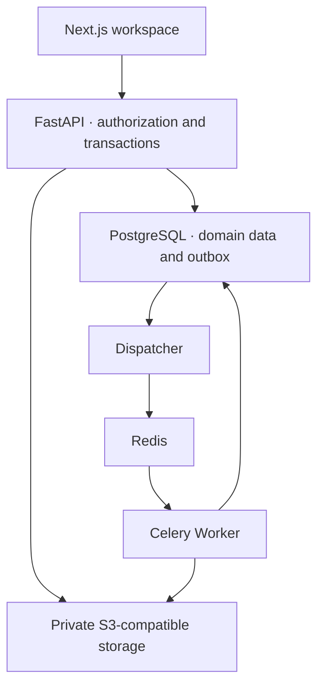

<p align="center"></p>

<h1 align="center">ResearchOS · From evidence to action</h1>

<p align="center">An open-source workspace for individual researchers.<br/>Connect questions, papers, evidence, hypotheses, decisions, and tasks in a traceable research workflow.</p>

<p align="center">
  <a href="LICENSE"></a>
  
  
  
  <a href="https://github.com/Fancy8/ResearchOS/actions/workflows/verify.yml"></a>
</p>

<p align="center"><b>English</b> · <a href="README_ZH.md">简体中文</a><br/>
<a href="#overview">Overview</a> · <a href="#features">Features</a> · <a href="#quickstart">Quick start</a> · <a href="#example">Example</a> · <a href="#documentation">Documentation</a> · <a href="#roadmap">Roadmap</a></p>

> **Early Alpha.** The research workflow and several recovery mechanisms are implemented; full release acceptance remains open. The CI badge shows actual hosted status. AI features and team collaboration are future scope.

<a id="overview"></a>

## 🎯 Overview

Can you find the original passage behind a research decision weeks later? Why was an experiment worth doing? When a hypothesis changes, can you still reconstruct what supported an earlier choice?

**ResearchOS organizes work around research questions and connects source evidence, your reasoning, and your next action.** Papers can be reused across projects. Evidence retains its source version and location. Decision revisions preserve their supporting context. Tasks link to the exact decision revision that motivated them.

It is intended for individual graduate researchers working on literature reviews, method comparisons, experiment planning, and research reviews. For developers, it is also a full-stack engineering example of using relational constraints, transactions, authorization, and recovery to support history-sensitive workflows.


## 🧑‍🔬 Find your starting point

| Your goal | Explore |
| --- | --- |
| Build a literature review with retrievable source passages | [Evidence and reasoning tour](docs/project-tour.md#follow-one-piece-of-evidence) |
| Turn a method comparison into a documented experiment plan | [Research workflow example](#example) |
| Evaluate the architecture and reliability mechanisms | [Engineering choices and code pointers](docs/project-tour.md#engineering-choices-behind-the-workflow) |
| Try the alpha or contribute a focused improvement | [Quick start](#quickstart) · [Contribution routes](#contributing) |

**What makes the workflow distinctive:** source identity, current interpretation, historical decisions, and planned actions are separate records connected by explicit references. A replacement PDF or a revised interpretation can coexist with the context preserved by an earlier decision.

## ✨ Design highlights

| Design | Implementation approach | Practical value |
| --- | --- | --- |
| **Evidence with provenance** | PDF file versions, pages, source anchors, and retained source checksums | Revisit the specific source behind a claim |
| **Decisions with history** | Immutable revisions and supporting-context snapshots | Distinguish what was known then from what is known now |
| **Actions with a rationale** | Tasks retain the exact originating decision revision | Trace an experiment plan back to its reasoning |
| **Recovery after interruption** | Original intent and transactional idempotency for creation, uploads, and exports | Recover unknown outcomes and reduce duplicate writes |
| **Private-object authorization** | Server-side ownership checks for objects and associations, with workspace-scoped caching | Apply a consistent boundary to reads, links, search, and exports |
| **Engineering with evidence** | Requirements mapping, OpenAPI contracts, Alembic migrations, real PostgreSQL, and fault cases | Connect requirements to implementation and verification |

[Explore the English guided tour →](docs/project-tour.md) Follow one piece of evidence, inspect recovery behavior, and find the relevant code and tests.

These describe implemented approaches, not a production certification. See [implementation status](docs/implementation-status.md) for validation boundaries.

<a id="features"></a>

## 🧩 Features

| Module | What you can do | Current boundary |
| --- | --- | --- |
| 🗂️ Projects and research threads | Organize questions, stages, and related material | Individual workspaces |
| 📄 Papers and PDF reading | Upload, parse, read, and retain historical file versions | Primarily text-based PDFs; no scanned-document OCR |
| 🔎 Research evidence | Save passages, pages, anchors, and your interpretation | Anchor quality requires validation; arbitrary layouts are not guaranteed |
| 💡 Hypotheses and decisions | Organize evidence, record choices, and preserve decision revisions | Researchers make scientific judgments |
| ✅ Tasks and review | Turn decisions into actions and revisit activity history | No autonomous experiment execution |
| 📝 Research notes | Edit structured notes and math, handle conflicts, and recover drafts | Browser recovery drafts contain plaintext research inputs |
| 📦 Search and exports | Find authorized records and export archives with manifests and checksums | Production-scale capacity and recovery remain release gates |

<a id="quickstart"></a>

## 🚀 Quick start

### 1. Prepare your environment

The current bootstrap targets **Windows x64 and PowerShell**. Install Git, **64-bit CPython 3.12**, and **Node.js 26.1.0 with npm**, and make the commands available in your terminal. Initial setup downloads pinned dependencies and local service binaries. Other Python versions and platforms cannot directly use the approved Windows CPython 3.12 wheel lock.

### 2. Clone and install

```powershell
git clone https://github.com/Fancy8/ResearchOS.git
cd ResearchOS
./tools/setup.ps1
```

Setup prepares a project-local Python environment, PostgreSQL, Redis, private object storage, migrations, and the application. Generated runtime data stays in ignored `runtime/`, outside the published source tree.

### 3. Create your workspace

```powershell
# Replace the example address. The command prints a local invitation token; it sends no email.
./runtime/venv/Scripts/python.exe ./tools/invite.py your-email@example.com
```

Open **[login and registration](http://localhost:3000/login)**. Switch to registration, enter the same email, invitation token, display name, and a password of at least 12 characters, then complete onboarding. Developers can use the [local API documentation](http://127.0.0.1:58000/api/docs).

<details>
<summary><b>Subsequent starts and development verification</b></summary>

Run from the repository root:

```powershell
./tools/start-services.ps1
./tools/start.ps1
# Complete development verification, using dedicated test databases:
./tools/verify.ps1
```

Verification uses real PostgreSQL and local object storage. Do not point it at production data. The [installation guide](docs/getting-started.md) covers version, download, registration, and startup checks; the detailed guide is currently in Chinese.

</details>

| Platform | Status |
| --- | --- |
| Windows x64 / PowerShell | Current development target; the complete hosted workflow has passed |
| Linux / macOS | No supported bootstrap or platform acceptance yet |
| Browser | Local automated coverage uses Playwright Chromium; other browsers and real mobile devices need validation |
| Production hosting | Platform isolation, operations, and capacity gates remain open |

<a id="example"></a>

## 🧪 A research workflow example

Try a **fictional learning-rate question** using a small text-based PDF you created. This is an illustrative workflow, not a study or a preloaded scientific conclusion.

| Step | Example record | Context to retain |
| --- | --- | --- |
| Ask | Does a smaller learning rate reduce late-training oscillation? | Project and research thread |
| Read | Upload your own sample PDF | Source version and parsing status |
| Capture | Save a passage and your interpretation | Page, anchor, and source |
| Decide | Record an unverified hypothesis and plan a controlled comparison | Supporting context and decision revision |
| Act | Fix the model, data, and seed; compare two learning rates | Task provenance and rationale |
| Review | Record observations, revise the decision, and export | Historical revisions and archive manifest |

The goal is to trace a planned action back to a decision and its evidence. The application does not establish the hypothesis or run the experiment. The [detailed walkthrough](docs/research-walkthrough.md) and [product baseline](docs/01-product-baseline.md) are currently in Chinese.

## 🏗️ Technology and engineering

| Layer | Technologies | Responsibility |
| --- | --- | --- |
| Web | Next.js, React, TypeScript, TanStack Query | Workspace, private cache, reading and editing |
| API | FastAPI, Pydantic, SQLAlchemy 2.0 | Identity, object authorization, contracts, transactions |
| Data | PostgreSQL, Alembic | Constraints, revisions, idempotency receipts, migrations |
| Background work | PostgreSQL outbox, Redis, Celery | Durable dispatch, parsing, export, recovery |
| Documents and storage | PDF.js, pypdf, Tiptap, private S3-compatible storage | Reading, mathematical notes, source files |



This diagram shows module relationships. Windows Celery solo is a local development arrangement; production platform support and full OS isolation need validation. See [architecture](docs/02-architecture.md) and [data/ORM design](docs/03-data-and-orm.md).

### Quality and verification

| Evidence | Result | Scope |
| --- | --- | --- |
| Hosted Windows workflow | [Complete run passed](https://github.com/Fancy8/ResearchOS/actions/runs/39583284264) | 2026-10-21, repair commit `de5ee22` |
| Backend and browser tests | 191 backend and 76 browser tests passed | Actual hosted execution; 1 backend warning |
| Additional gates | 25 dependency-tool tests, 3 math-security tests, typecheck, build, contracts, and migrations passed | See [CI verification notes](docs/ci-verification.md) |
| Earlier local validation | 191 backend and 76 browser tests passed on 2026-10-16 | Historical local evidence, application source through `ecb1afe` |

The badge links to current hosted status. Passing this workflow does not close all production release gates or establish an independent security certification. The public snapshot excludes local credentials, databases, private original material, and test traces; see [publication notes](docs/publication-notes.md).

<a id="documentation"></a>

## 📚 Documentation

Most detailed guides and design documents are currently **in Chinese**. This English homepage and the [guided tour](docs/project-tour.md) provide the project overview, installation commands, workflow examples, engineering rationale, and contribution routes.

| Start here | Contents | Audience |
| --- | --- | --- |
| [English guided tour](docs/project-tour.md) | Research scenarios, engineering choices, recovery example, repository map | New readers and technical evaluators |
| [Installation](docs/getting-started.md) | Environment, registration, startup, troubleshooting | New users and contributors |
| [Research walkthrough](docs/research-walkthrough.md) | Evidence, decisions, and tasks using synthetic material | Researchers |
| [Product baseline](docs/01-product-baseline.md) | F01–F15, business rules, acceptance mapping | Product and QA |
| [Architecture](docs/02-architecture.md) | Modules, data, and task flow | Full-stack developers |
| [Data/ORM](docs/03-data-and-orm.md) / [API contract](docs/04-api-contract.md) | History, authorization, idempotency, protocols | Backend and frontend developers |
| [Experience design](docs/05-experience-design.md) | Pages and interaction states | Frontend and design |
| [Delivery plan](docs/06-delivery-plan.md) / [Quality plan](docs/07-quality-and-operations.md) | Issues, tests, release gates | Maintainers and QA |
| [Implementation status](docs/implementation-status.md) / [CI evidence](docs/ci-verification.md) | Verified scope and remaining work | Contributors |

👉 [Full documentation map and suggested reading order](docs/README.md)

<a id="roadmap"></a>

## 🧭 Roadmap

- **Alpha acceptance:** multi-tab contention, late responses, corrupt/expired drafts, failure states, and accessibility.
- **Reproducible maintenance:** ongoing hosted CI, broader clean-environment coverage, dependency and service-binary review.
- **Release validation:** production isolation, capacity, independent recovery witnesses, backup key escrow, and real email providers.
- **After product validation:** scoped AI assistance, import integrations, and collaboration with separately reviewed data authorization and permission models.

These are directions, not shipped features or promised dates. See the [detailed roadmap](docs/roadmap.md).

## 🤝 Contributing

| I want to… | Route |
| --- | --- |
| Report a reproducible bug or concrete feature request | [Issues](https://github.com/Fancy8/ResearchOS/issues) |
| Discuss installation, research workflows, or general ideas | [Discussions](https://github.com/Fancy8/ResearchOS/discussions) |
| Improve code, tests, translation, or documentation | [Contribution guide](CONTRIBUTING.md) |
| Report a vulnerability privately | [Security policy](SECURITY.md) |

Useful starting points include documentation links, setup reproduction, synthetic PDF compatibility cases, failure-state tests, and accessibility. Development uses AI-assisted tools; maintainers remain responsible for review and release decisions. Share only material you are authorized to publish.

## ❓ FAQ

<details>
<summary><b>Is this an autonomous AI research tool?</b></summary>

The current focus is research records and evidence traceability. Researchers decide hypotheses, conclusions, and next steps. AI question answering and research navigation are future scope.

</details>

<details>
<summary><b>Can I deploy it to real users today?</b></summary>

It is an early alpha. Security, PDF compatibility, accessibility, capacity, production platform, backup, and real-user acceptance gates remain open. Launchers bind to loopback; fixed storage development credentials are not production settings.

</details>

<details>
<summary><b>What should stay out of the public repository?</b></summary>

Real credentials, databases, private PDFs, sessions, browser traces, and unredacted logs. Migrations, synthetic fixtures, and reviewed summaries can be contributed. Keep `runtime/` and `artifacts/` ignored.

</details>

<details>
<summary><b>How should I read the CI badge and historical test results?</b></summary>

The badge shows hosted workflow status. Dated local runs are separate evidence. The [2026-10-21 repair run](https://github.com/Fancy8/ResearchOS/actions/runs/39583284264) passed the complete Windows workflow; future runs may reveal new failures.

</details>

## 📄 License and acknowledgments

Original code is available under the [MIT License](LICENSE). Adapted FastAPI template code, Open Notebook components, PDF.js, and other dependencies retain their own notices; see [THIRD_PARTY_NOTICES.md](THIRD_PARTY_NOTICES.md) and `licenses/`.

The homepage organization takes inspiration from [Datawhale Hello-Agents](https://github.com/datawhalechina/hello-agents). ResearchOS prose, cover, and workflow artwork were made for this project; no affiliation or endorsement is implied.

<p align="center"><b>Keep the source. Preserve the reasoning. Connect your next step to the research question.</b></p>
