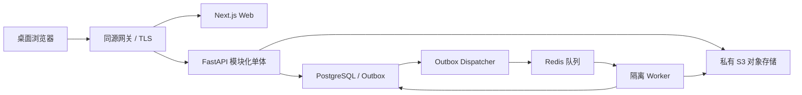

# 系统架构与模块边界

依据 S1 第 16 节、S2 BE-01/16/17；本次补充可靠性、权限边界与部署设计。

## 架构选择

采用模块化单体：一个 FastAPI 业务系统统一处理认证、对象授权、事务和 REST API；同一代码仓库构建独立 Worker 进程执行 PDF 解析、导出和清理。前端、API 和 Worker 可独立扩容，但共享领域模型与迁移链。



文本说明：浏览器通过同源网关访问 Web 和 API；所有私有对象读取由 API 授权。数据库先持久化任务和 outbox，再派发队列；Worker 使用租约领取任务，结果写回数据库和私有存储。文件传输可以使用限时授权地址，最终归属与可用状态仍由服务端确定。

## 技术基线与替代路径

| 层 | 设计选择 | 使用边界与验证 |
| --- | --- | --- |
| Web | Next.js、TypeScript、Tailwind、shadcn/ui | App Router；业务写入只走 FastAPI；浏览器专用阅读器/编辑器作为客户端组件 |
| 数据请求 | TanStack Query | query key 包含当前账号/空间/课题；退出清空缓存；私有响应不进入共享静态缓存 |
| 临时状态 | React 状态；必要时小范围 Zustand | 不复制服务端实体作为另一套事实 |
| PDF | PDF.js | 文本层、虚拟页渲染、缩放/旋转；应用与 worker 资源版本一致 |
| 笔记 | Tiptap JSON + 服务端纯文本派生 | 限定节点类型，导出 Markdown；禁止任意脚本和 HTML 执行 |
| API | FastAPI + Pydantic | 输入、输出与 OpenAPI 同一 schema；错误统一映射 |
| 数据 | PostgreSQL 16 系列作为兼容验证基线 | 不声称该版本最新；UUID、TIMESTAMPTZ、JSONB、复合 FK、部分索引 |
| ORM/迁移 | SQLAlchemy 2.0 API + Alembic | 尊重材料指定 2.0；S0 评审维护状态、锁定兼容补丁与迁移验证环境 |
| 后台任务 | Celery + Redis + PostgreSQL outbox | 队列不作为唯一任务账本；API async session，Worker 独立同步 session |
| PDF 文本提取 | pypdf 技术验证后使用 | 只承担文本/页数提取；不承诺扫描 OCR 或稳定还原所有布局 |
| 存储 | S3 兼容私有桶 | 以权限、复制、版本与签名语义验收具体供应商；本地可用兼容服务 |
| 运行 | 容器、同源网关、结构化日志和指标 | 开发 Compose；生产优先托管 DB/对象存储，发布地区与供应商待定 |

S0 固定 Node/Python、依赖及容器镜像版本，提交 lockfile 和依赖清单；不使用浮动 `latest` 构建发布版本。每次升级按 PDF、编辑器、迁移和认证回归评估。技术选择不是已安装或已部署的事实。

pypdf 官方说明了扫描 PDF 和文本提取的限制，因此本方案保留人工页码级证据路径。[pypdf 官方源码说明](https://github.com/py-pdf/pypdf/blob/main/docs/user/extract-text.md)

## 模块职责与依赖

| 模块 | 拥有对象 | 提供能力 | 可以依赖 |
| --- | --- | --- | --- |
| identity | users/workspaces/sessions/auth_tokens/profile | 会话、空间上下文、画像、初始化 | 基础设施 |
| research | projects/threads/thread_revisions | 课题、研究问题、阶段与归档 | identity |
| papers | papers/files/pages/关联/upload_sessions | 上传、去重、文件版本、授权阅读 | identity、research |
| evidence | evidence | 来源校验、解释编辑、证据复用 | papers、research |
| hypotheses | hypotheses/revisions/links | 人工判断与证据关系 | research、evidence |
| decisions | decisions/revisions/依据快照 | 决策修订、历史复盘 | research、evidence、hypotheses、notes 的只读接口 |
| tasks | tasks | 下一步行动与状态 | research、decisions |
| notes | notes/四张关联表 | 编辑、自动保存、引用 | research、papers、evidence |
| activity | activity_events | 事务内追加事件、授权时间线 | 各模块提供的事件 |
| dashboard/search | 无独立业务真值表 | 权限内聚合与检索 | 各模块只读查询 |
| exports/deletion | export_jobs/deletion_jobs | 档案快照、影响检查与受控清理 | 上述模块受控接口 |

路由负责验证和调用；Service 负责对象授权、业务规则和事务；Repository 负责查询且强制接收 WorkspaceContext；Model 负责数据库映射。一个业务动作只有一个 Unit of Work，禁止 Repository 内私自 commit。跨模块查询使用明确的服务接口/只读投影，避免双向导入；不引入通用万能 CRUD。

## 关键可靠性协议

业务数据、活动事件、幂等结果及 outbox 在同一数据库事务提交。Dispatcher 从已提交 outbox 派发消息，可能重复派发；Worker 通过数据库 job 状态、租约和 attempt_token 抵御重复与过期写入。Redis 恢复后可从 outbox 补发。

Celery 的晚确认要求任务具备幂等性，也不能替代对 Worker 异常退出的处理。本方案以数据库持久状态及租约回收作为额外保障。[Celery 官方任务文档](https://docs.celeryq.dev/en/stable/userguide/tasks.html)

Worker 领取时原子更新 lease_owner、lease_expires_at、attempt_token、attempts；处理时续租。提交结果必须满足当前 attempt_token 和租约仍有效。失联超时进入可重试状态，最多 3 次；格式错误不重试，临时存储/队列错误退避重试。过期 Worker 的结果被丢弃，不能覆盖新尝试。

对象存储与 PostgreSQL 不具有共同事务：文件先固定在最终键，数据库事务提交引用；提交失败的孤儿文件由延迟扫描清理。清理必须核对无活跃上传/导出、无证据/备份保留引用；不能靠文件名或创建时间直接删除。

## 安全边界与部署拓扑

浏览器是非可信客户端。workspace_id、actor_id、签名键及定位精度都不能由它决定。API 根据会话查空间所有权，并验证每个关联对象。缓存、搜索、导出、日志跳转和历史文件访问应用相同授权。

PDF 解析进程以低权限运行，限制 CPU、内存、时长、临时目录和外网访问；解析超时/恶意文件不得拖垮 API。元数据 URL 不自动抓取，避免引入未经设计的服务端请求功能。

| 环境 | 数据和入口 | 设计配置 |
| --- | --- | --- |
| dev | 合成/公开许可样本；本地端口 | Compose，开发凭据，邮件捕获器 |
| CI | 每次任务独立 DB/桶前缀 | 可重复 seed，双账号，迁移与契约检查 |
| staging | 与生产隔离；匿名化样本 | 与生产同构镜像、权限、TLS、恢复演练 |
| production | 私有科研资料 | 托管备份、私有桶、最小权限、独立密钥、监控和值班 |

公网只暴露网关；数据库、Redis 和 Worker 使用私有网络。生产会话密钥、存储密钥和邮件凭据使用秘密管理，不能写入代码或镜像。API 与 Worker 连接池总数计入 PostgreSQL 最大连接容量，导出读取使用有界独立池。

## 计划工程目录

下列目录是后续实施结构，不表示当前应用代码已经存在。

```text
ResearchOS/
  frontend/src/{app,features,components,lib,generated}
  backend/app/
    api/                 # FastAPI 路由与错误映射
    core/                # 配置、认证上下文、日志
    db/                  # Base、session、Unit of Work
    modules/             # 各模块 models/schemas/services/repositories
    workers/             # dispatcher、parse、export、deletion
  backend/alembic/versions/
  backend/tests/{unit,integration,contract}
  e2e/                   # Playwright 主闭环和故障场景
  infra/                 # 容器、网关、环境与监控配置
  contracts/             # OpenAPI 快照与生成配置
  docs/                  # 需求、ADR、验收、运行手册
```
